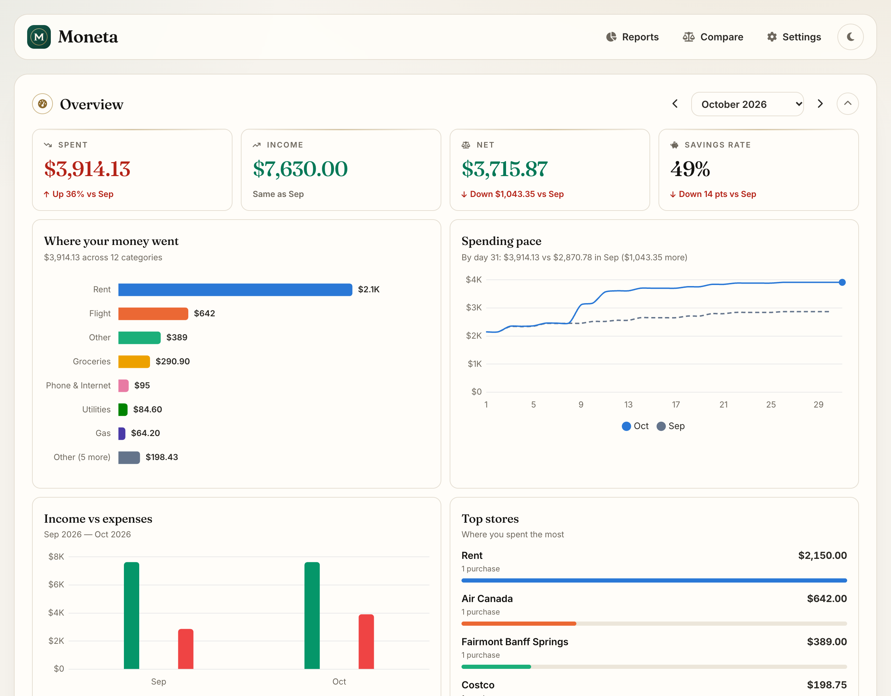
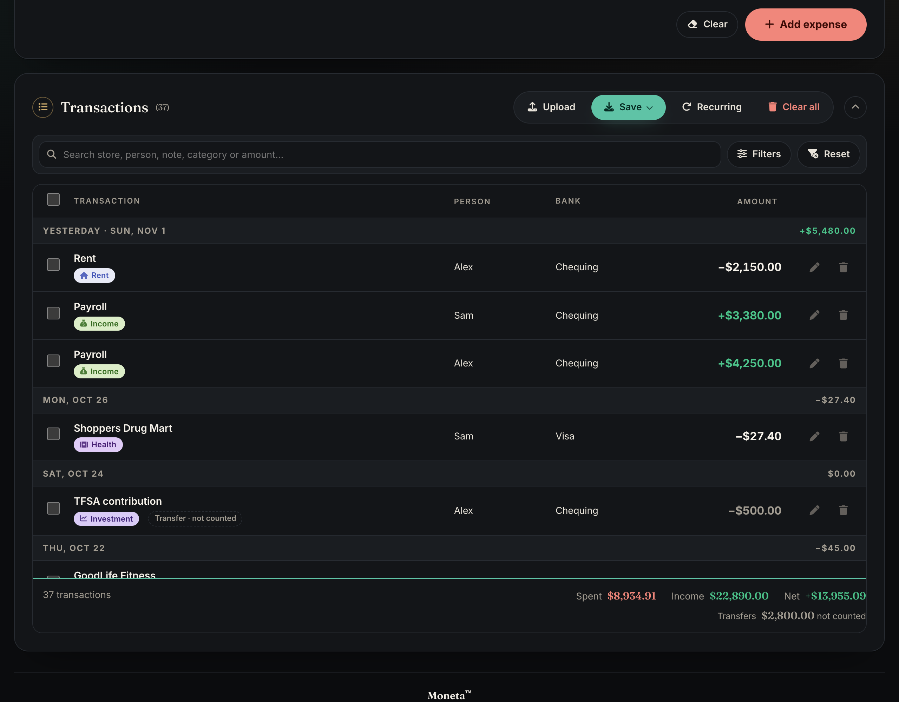

<p align="center">
  
</p>

<h1 align="center">Moneta</h1>

<p align="center">
  <strong>Your money, beautifully in order.</strong><br>
  A private household finance app that turns your Excel files and bank statements into a clear picture of
  where your money goes — without a bank login, an account, or anything leaving your device.
</p>

<p align="center">
  <a href="https://sharsha2.github.io/SpendWise/"><strong>Open Moneta →</strong></a>
</p>



## The privacy promise

- **Stays on your device.** Files are read in your browser. Nothing is uploaded, and the app talks to no other server.
- **No bank login.** You bring your own Excel files or statement PDFs.
- **No account, no ads, no tracking.** There is nothing to sign up for.
- **Works offline** once it has been opened.

Your data lives in your own Excel files. Moneta only keeps your settings, and any unsaved work, in this browser.

## What it does

- **Dashboard** — spent, income, net and savings rate for any month, with changes from the month before
- **Where your money went** — spending by category, spending pace, income vs expenses, top stores
- **Couples & households** — who paid what, and who owes whom to share costs equally
- **Budgets** with on-track / at-risk / over-budget status and a month-end forecast
- **Savings goals**, **bill reminders** and **subscription detection**
- **Bank statement PDFs** — import a statement and review every line before adding it
- **Reports** — category, monthly, bank and per-person charts, a year summary, and monthly or annual **PDF reports**
- **Notes & tags** (e.g. "Banff trip"), split transactions, bulk edits, keyboard shortcuts
- **Light and dark themes**, phone and desktop layouts



## How to use it

1. **Open the app.** Not ready to use your own numbers? Choose **Explore with sample data**.
2. **Bring your data** with **Upload** — an Excel file from Moneta (old ones work too) or a bank statement PDF —
   or add transactions by hand. Store names complete as you type.
3. **Save** with **Save ▾ → Excel**. Each month is kept in its own file; in Chrome or Edge, Save updates the
   file you opened. **Save ▾ → PDF report** makes a summary to keep or share.
4. **Next time**, upload the same month's file and carry on. Unsaved work is offered back if you close the tab.

**Tip:** keep your monthly files in iCloud Drive or Google Drive to use them on both phone and computer.

### Excel format

One row per transaction. Moneta writes these columns and reads any file that has them; `Category` and
`Notes` are optional, and a workbook can have one sheet per month.

| Date | Purchased By | Purchased Store | Bank Name | Category | Debit [D] | Credit [C] | Amount Total | Notes |
|---|---|---|---|---|---|---|---|---|
| 2026-11-03 | Alex | Costco | Visa | Groceries | 186.40 | | 186.40 | |

### How totals are counted

- **Spending** is money out; **income** is money in.
- **Card payments, transfers between your own accounts and investing** are shown but not counted, so nothing is counted twice.
- **Refunds** lower spending in their category. Money back with nothing to cancel (a tax refund, a transfer from someone) counts as income.

## Running it yourself

Moneta is plain HTML, CSS and JavaScript with no build step.

```bash
# serve the folder and open http://localhost:8000
python3 -m http.server 8000

# tests
node tests.js           # unit tests (calculations, parsing)
npm ci && npm run test:e2e   # browser tests in headless Chrome
```

Pushing to `main` runs the tests and deploys to GitHub Pages
(`.github/workflows/ci.yml`; set **Settings → Pages → Source** to **GitHub Actions** once).

## Project layout

| Path | What's there |
|---|---|
| `index.html`, `styles.css`, `app.js` | The app |
| `statement-import.js` | Reading bank statement PDFs and Moneta PDF reports |
| `sw.js`, `manifest.webmanifest` | Offline support and install as an app |
| `vendor/` | Self-hosted libraries and fonts (SheetJS, Chart.js, pdf.js, Font Awesome, Inter, Fraunces) with their licences |
| `tests.js`, `tests/e2e.js` | Unit and browser tests |
| `docs/` | Design direction and screenshots |

## License

[MIT](LICENSE) © 2026 Harsha Karuturi. Bundled libraries and fonts keep their own licences (see `vendor/`).
